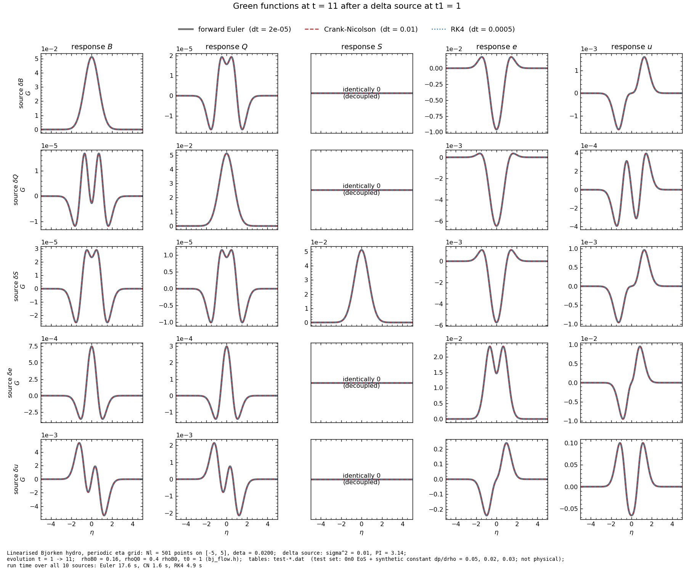
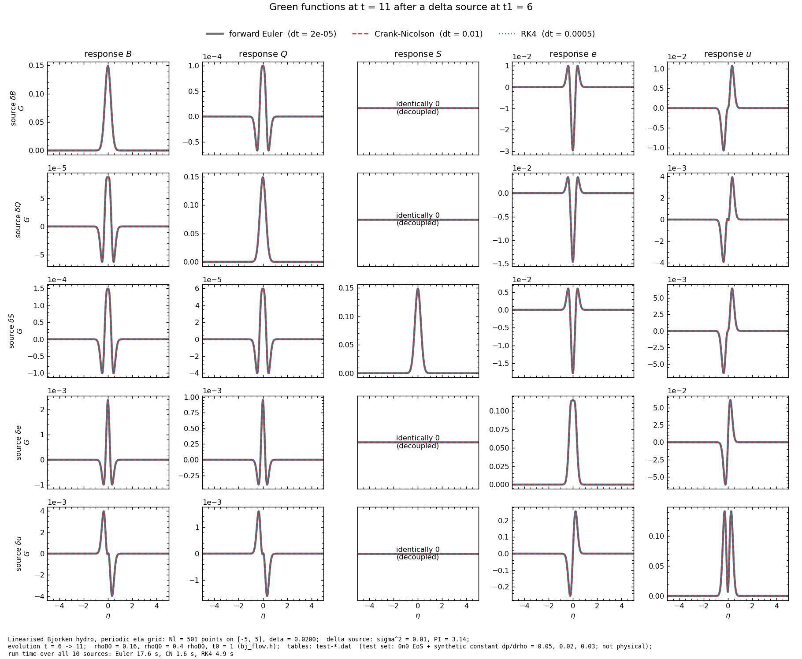
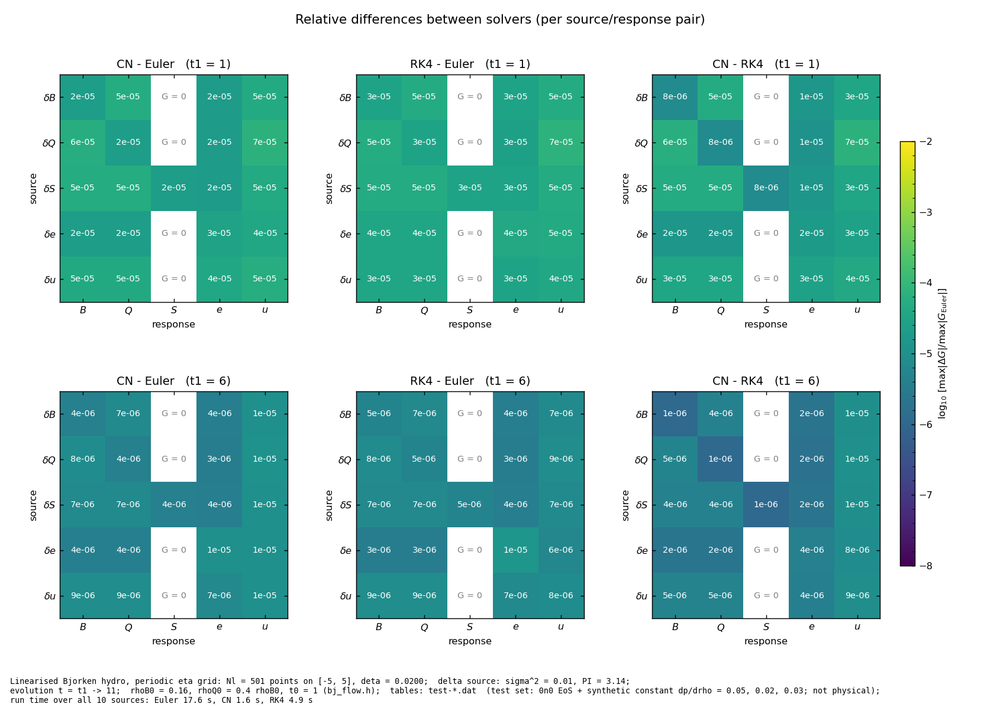

# Hydro-fluks (3-charge EoS)

C++ code for a 1D Bjorken-flow hydrodynamic model with conserved baryon, electric
charge and strangeness densities. It evolves a delta-function perturbation in each of
the conserved quantities and records the response (Green's functions / correlation
functions) in spatial rapidity. Python notebooks build the equation-of-state input.

## Contents

| File | Purpose |
|---|---|
| `bj_flow.h`, `bj_flow.cpp` | `bj_flow` class: Bjorken flow solver (grid `Nl = 501`, `eta_max = 5`) |
| `Hydro-fluks.cpp` | Driver: loops over start times, perturbs each charge in turn, writes `Green-<source>-<response>.dat` |
| `bj_flow_cn.h/.cpp` | `bj_flow_cn`: **Crank-Nicolson** solver (implicit, 2nd order, unconditionally stable, ~10x faster than the explicit code at `dt = 0.01`) |
| `bj_flow_rk4.h/.cpp` | `bj_flow_rk4`: **Runge-Kutta 4** solver (explicit, 4th order, `dt` 25-50x larger than forward Euler, limited by diffusion stability) |
| `Hydro-fluks-cn.cpp` | Green-function driver for the CN solver; built with `-DUSE_RK4` (`make Hydro-fluks-rk4`) it uses RK4 instead |
| `tests/` | Validation programs `test_cn.cpp`, `test_rk4.cpp` and the small test tables `test-*.dat` |
| `compare/` | `compare_solvers.cpp` (Green functions from Euler, CN and RK4), `plot_green_comparison.py`, and the data in `compare/results/` |
| `docs/figures/` | Comparison figures (below) |
| `Makefile` | See the table of make targets below |
| `eos-3mu.ipynb` | Hadron-resonance-gas EoS with three chemical potentials (uses `pdg2020`) |
| `lattice-eos-fits-v1/-v2.ipynb` | Polynomial/Pade fits of lattice EoS data (v2 is the later version) |
| `pdg2020` | PDG hadron list (mass, degeneracy, B, Q, S, ...) |
| `*-n-1n0.dat` | Tabulated EoS quantities (T, e, p, s, mu, chi, c_B^2, c_Q^2, c_S^2) vs. density |

## Build and run

| Command | Result |
|---|---|
| `make` / `./Hydro-fluks` | Original forward-Euler solver (`dt = 2e-5`) |
| `make Hydro-fluks-cn` / `./Hydro-fluks-cn [dt=0.01] [Ntstart=500] [prefix=1n0] [out_dir=.]` | Crank-Nicolson Green functions, same output files as `Hydro-fluks` |
| `make Hydro-fluks-rk4` / `./Hydro-fluks-rk4 [dt=2e-4] [Ntstart=500] [prefix=1n0] [out_dir=.]` | RK4 Green functions (same arguments). Keep `dt` below the diffusion limit, about 1e-3 at `t = 1` for the test tables, growing like `t^2` |
| `make test` | Explicit vs Crank-Nicolson, convergence in `dt` |
| `make test-rk4` | RK4 against a very-small-step RK4 and against the explicit code |
| `make compare` | Runs all three solvers on the same problem (about 30 s) and writes `compare/results/*.dat` and the figures in `docs/figures/` |

The solver reads transport/EoS tables named `<name_rho>-{Mst,dMst,etas,dpde,dpdrhoB,dpdrhoQ,dpdrhoS,D}.dat`
(`name_rho` is set in `bj_flow.h`, default `1n0`) from the working directory. Example tables
for `0n0` are in the `eta2tau13` project.

## Solver comparison

`make compare` computes the Green functions at `t = 11` for a delta source in each of the five fields (`B, Q, S, e, u`) started at `t1 = 1` and `t1 = 6`
with the three solvers and plots them. Every figure carries the run parameters.

* All three solvers agree: the curves lie on top of each other, and the largest relative difference per source/response pair is 7e-5 at `t1 = 1` and 1e-5 at `t1 = 6` (the difference to forward Euler is mostly Euler's own first-order error).
* Run time for the ten runs: forward Euler (`dt = 2e-5`) 17.6 s, RK4 (`dt = 5e-4`) 4.9 s, Crank-Nicolson (`dt = 0.01`) 1.6 s.
* `S` only responds to a source in `S` (the response panels for the other sources are exactly zero).
* **The figures were made with the test tables in `tests/`**: the `0n0` EoS and transport tables with *synthetic constant* `dp/drho` tables (0.05, 0.02, 0.03). The `1n0-*` tables are not in this repository,
  so the curves are not physical. To redo the figures with real tables, put them in a folder with a common prefix and run `compare/compare_solvers <prefix> compare/results` from that folder, then `python3 compare/plot_green_comparison.py`.

## Known issues (left unchanged on purpose)

- `delta()` in `Hydro-fluks.cpp` uses `PI = 3.14`; use `M_PI` if the exact Gaussian normalisation matters.
- The `Noutput` variable is unused (compiler warnings).
- In `dP`, the explicit code (and by default CN/RK4, to stay comparable) uses `dBP` in front of `Q` where `dQP` looks intended; `bj_flow_cn`/`bj_flow_rk4` take `fix_dQP_in_pressure = true` to use `dQP`.
- The notebooks load data from `../datasets/` which is not part of this repository.

Further documentation: [docs/index.md](docs/index.md)
